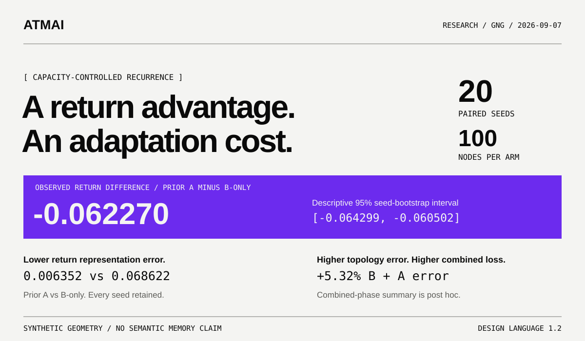

# Geometric recurrence at a fixed node budget

ATMAI design v1.2 | Frozen experiment `exp-20260907-8313df3e`

**Prior A exposure improves return representation, with a cost in topology and adaptation to B.** This page presents existing evidence from the unchanged `canonical-gng-v1` engine.

GitHub renders this Markdown page and its SVG overview. The [browser report](index.html) is an HTML file: download or clone the repository and open that file in a browser. GitHub's file view does not run the report.

## What was compared

The preregistered panel contains **20 paired seeds and a 100-node cap**. Each model receives 10,000 warmup updates, then two phases of 4,096 updates. The primary pair compares A warmup, then B, then return to A against B warmup, then B, then A. Corresponding postwarmup samples are identical within each seed.

All warmup models reached 100 live nodes. The primary pair's realized node counts matched at every preupdate and postupdate step in both phases. No seeds were excluded. Edge counts and learned geometry were not matched.

## Return to A

The primary paired mean difference in return squared quantization error, prior A minus B-only history, is **-0.062270330687**. Its descriptive 95% seed-bootstrap interval is **[-0.064298691355, -0.060502391565]**, using 10,000 resamples of the 20 paired seed outcomes.

| Return measurement | Prior A, then abrupt B | B-only history |
| --- | ---: | ---: |
| Mean squared quantization error (QE) | 0.006351514506 | 0.068621845192 |
| Mean topographic error (TE) | 0.018481445313 | 0.010400390625 |
| QE recovery confirmed by 4,096 samples | 20 / 20 | 0 / 20 |
| QE recovery right-censored at 4,096 samples | 0 / 20 | 20 / 20 |
| Joint QE and TE recovery confirmed by 4,096 samples | 20 / 20 | 0 / 20 |
| Joint recovery right-censored at 4,096 samples | 0 / 20 | 20 / 20 |

Lower is better for both errors. QE measures squared distance to a prototype; TE measures whether the nearest two prototypes lack an edge. **All 20 seeds have lower return QE and higher return TE after prior A exposure.** The mean TE difference is **+0.008081054688**.

Recovery uses declared operational thresholds and two consecutive qualifying 256-sample windows. Prior-A QE confirmation takes **512 to 1,536 return samples**. Confirmation differs from retrospective onset; zero-sample onset still requires at least 512 samples. Censoring means recovery was not confirmed within the observation horizon, not that it can never occur.

## The preceding cost

| Mean squared quantization error | Prior A, then abrupt B | B-only history |
| --- | ---: | ---: |
| Preceding B phase | 0.071686997180 | 0.005476231261 |
| Both equal-length B and A phases | 0.039019255843 | 0.037049038227 |

The combined phase average is an explicitly **post hoc descriptive calculation** from retained losses. Prior A is approximately **5.32% worse** on this summary. It is not the preregistered primary estimand and has no additional statistical test.

Capacity and total update counts match, but lifetime B exposure differs: **4,096 B samples** for prior A versus **14,096** for B-only history. Warmup distribution is the treatment. A return-only advantage does not establish general adaptation superiority.

## What the evidence supports

This fixed synthetic translation protocol shows history-dependent geometric adaptation at matched live-node capacity. The interval describes this seed panel; it is not a confirmatory population claim. The experiment does not evaluate semantic identity, labels, drift detection, explicit retrieval or a new memory mechanism. Component centroids do not measure individual-node dormancy.

## Reproduction status

The recorded [reference CI run passed at revision 9a24419](https://github.com/ATMAI-Labs/Growing_Neural_Gas-Model_Lab/actions/runs/34085800521). The required reference job uses macOS arm64 and CPython 3.14.7, with Linux validation and unit tests as a prerequisite.

The earlier [full Linux replay failed](https://github.com/ATMAI-Labs/Growing_Neural_Gas-Model_Lab/actions/runs/34084904065) on exactly two rounded window-loss fields, each differing by about 10^-12. All other compared fields matched, including primary outcomes, intervals, recovery decisions and capacity checks. The exact-replay failure remains recorded; no tolerance or extra exclusion was added. Its numerical cause remains unresolved. See the [portability record](../../portability.md) for the exact fields and runtime scope.

## Evidence and next work

- [Frozen protocol and findings](../../../labs/002-controlled-drift/experiments/exp-20260907-8313df3e-capacity-controlled-recurrence/README.md)
- [Retained JSON with all 20 seeds](../../../labs/002-controlled-drift/experiments/exp-20260907-8313df3e-capacity-controlled-recurrence/results/capacity-controlled-recurrence.json)
- [Original evidence report](../../../labs/002-controlled-drift/experiments/exp-20260907-8313df3e-capacity-controlled-recurrence/results/report.html)
- [Research roadmap](../../roadmap.md): characterize when retained geometry helps recurrence or consumes useful capacity, then evaluate one intervention at a time.
- [Issue #10](https://github.com/ATMAI-Labs/Growing_Neural_Gas-Model_Lab/issues/10): harden a versioned successor while preserving the canonical reference.
- [Issue #11](https://github.com/ATMAI-Labs/Growing_Neural_Gas-Model_Lab/issues/11): isolate numerical-runtime portability differences.

This presentation does not change the frozen experiment, its protocol or its scientific claims.

See [presentation provenance and build instructions](PROVENANCE.md) for the v1.2 source references and deterministic report checks.
